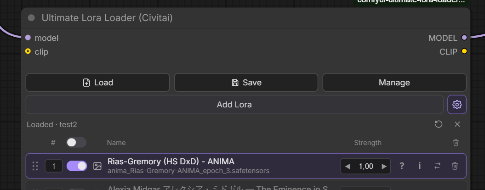
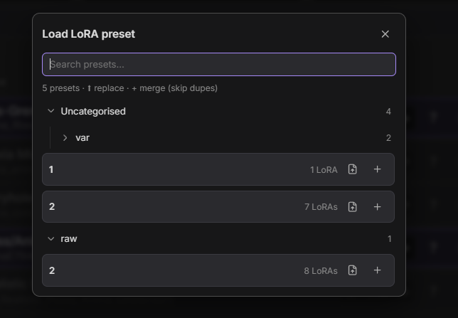
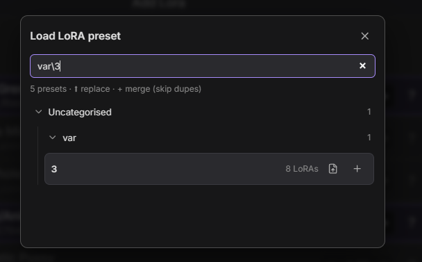
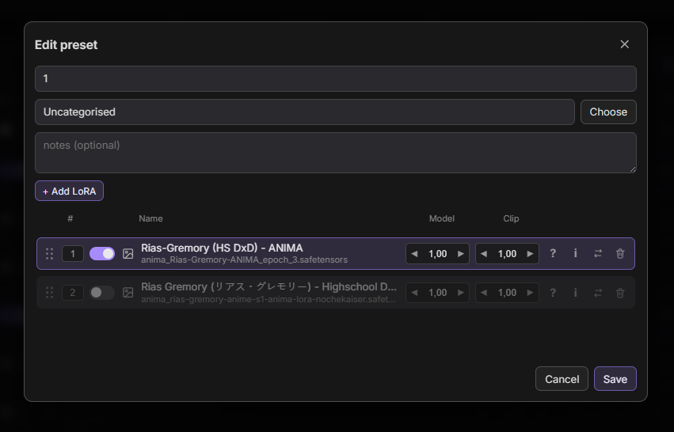

# 1.4.0 — LoRA presets

Save / load / manage LoRA stacks as SQLite presets (shelves like Prompt Craft), plus a gear to hide the toolbar when you don’t need it.

## What’s new

### Presets

- **Load / Save / Manage** on the node — store stacks with category shelves (`Uncategorised/var/…`)
- **Load:** Replace (full stack) or Merge (skip duplicate paths)
- Nested folder tree on Load / Manage (Prompt Craft style: indent + left rule)
- Path search: `folder\name` / `folder/sub/title` keeps nesting (no flat hit list)
- Icon actions: Replace = file-up, Merge = `+`; Manage rename/delete = pencil / trash
- **Edit preset:** same row chrome as the node (toggle, strengths, ⇄ swap, heal missing)
- **Loaded ·** chip with reload / detach bind after Replace (Merge keeps current bind)
- Save option: skip disabled LoRAs (toggle, persisted)

### Settings gear

- Small **⚙** next to **Add Lora** opens a Settings dialog
- Global toggle **Presets (Load · Save · Manage)** — SQLite, applies to **every** node copy
- Off by default: hides toolbar **and** the Loaded chip (bind still stored in `loras_data`)
- Gear stays neutral (no purple “active” state)

### Also

- Add Lora search: path segments via `/` or `\`; folder tree preserved in results (no per-file path duplicate under group headers)

## Soft deps (unchanged)

- Civitai Toolkit — names, covers, base model, `?`
- ComfyUI-Custom-Scripts — `i` (View Lora info)
